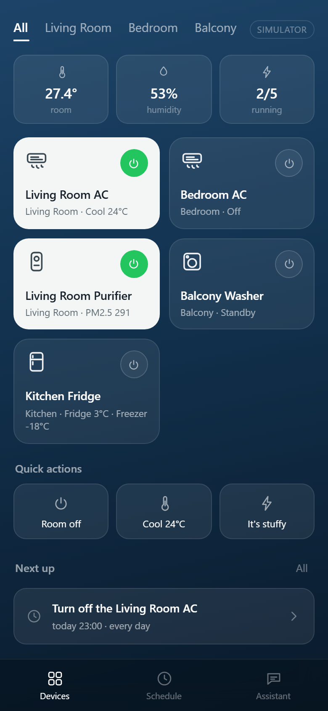
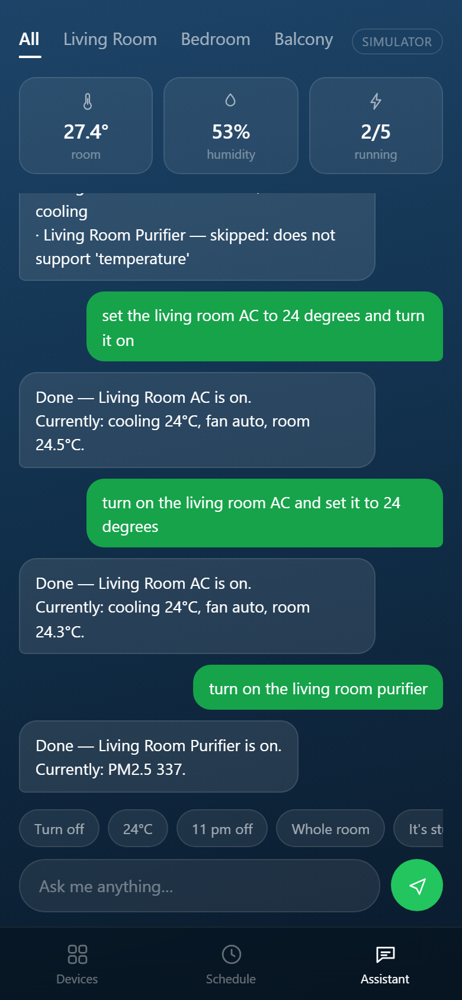

# LG Smart Home Agent


A conversational agent for a whole-home LG appliance setup. You talk to it in plain
English, and it both acts immediately and schedules future actions — *"turn off the
living room AC every night at 11 pm"* becomes a durable task that actually fires.

It ships as a phone app: an installable PWA you can add to the home screen, and the
same files package into an Android APK with Capacitor. No framework, no build step.

It answers in three tiers — deterministic rules for what they cover, a single model call
for the rest, and a bounded tool loop for requests that need to look at the house before
deciding. Section 2 explains why that order is the point.

 

```
You    turn on the living room AC
Agent  Done — Living Room AC is on.
       Currently: cooling 26°C, fan auto, room 29.4°C.

You    set it to 24 degrees
Agent  Done — Living Room AC set to 24°C.
       Currently: cooling 24°C, fan auto, room 29.3°C.

You    set everything in the living room to 24 degrees
Agent  Done — 1 of 2 devices updated:
       · Living Room AC — set to 24°C
       · Living Room Purifier — skipped: does not support 'temperature'

You    turn off the AC every night at 11 pm
Agent  Scheduled — every day at 23:00: turn off the Living Room AC.
       Next run: Oct 17, 23:00 (job f7385f4db3)

       23:00  ⏱ Scheduled task ran · Living Room AC · Success: turn off
```

---

## 1. What it does

| Capability | Example |
|---|---|
| Immediate control | `turn on the living room AC` |
| Temperature | `set the bedroom AC to 22 degrees` |
| Mode and fan | `switch the AC to heat and fan low` |
| Status | `what's the temperature in the bedroom?` |
| One-time schedule | `turn off the AC at 11 pm` · `in 30 minutes stop the washer` |
| Daily schedule | `turn off the AC every night at 11 pm` |
| Weekday / weekly | `every weekday at 7 am turn on the bedroom AC` · `every Monday and Wednesday at 8 am` |
| Interval | `every 2 hours turn on the purifier` |
| Manage schedules | `what scheduled tasks do I have?` · `cancel all` |
| **Several devices at once** | `set everything in the living room to 24 degrees` · `turn off all the ACs` |
| **Dialogue state** | `it's stuffy in here` → `Which room?` → `bedroom` |
| **Goals, not commands** | `the bedroom is a sauna, sort it out` → reads the room, then cools it |
| **Whole-home in one breath** | `everything off, I'm leaving` → all five devices |
| **Looks before it acts** | `the air in here is disgusting` → checks PM2.5, runs the purifier |
| **Phone app** | installable PWA: room tabs, a per-device control sheet, one-tap quick actions |

It understands times as people actually say them: `10:30 pm`, `at 7 am tomorrow`,
`half past ten`, `quarter to eight in the evening`, `in half an hour`.

---

## 2. Six design decisions worth defending

### The language model is not the timer

The obvious implementation — let the model remember "23:00, turn the AC off" — fails
silently. A model holds no state: restart the process and the pending action is gone,
with nothing to notice it. An expired token or a dropped connection has the same effect.

This project splits the job in two:

```
"turn off the AC at 11 pm"
   │  parse only
   ▼
{"device_id":"ac_living","actions":[…],"rule":{"type":"once","run_at":"…T23:00:00"}}
   │  persist
   ▼
SQLite.jobs  ──►  scheduler thread (1 Hz)  ──►  device adapter
                        │
                        └──► result written back + pushed into the chat
```

The model *understands*; a scheduler thread *waits and executes*. That is why you see
`⏱ 23:00 Scheduled task ran · Success: turn off` in the conversation — you can check
whether last night's run actually happened.

### And when the run was missed, you are told

Durability has an uncomfortable corollary that most demos skip. A task stored in SQLite
survives a restart — but if the process was down at 23:00, that run did not happen.
Pretending otherwise is worse than failing: the user believes the AC went off.

On startup the scheduler reconciles instead of guessing:

| Situation | What happens |
|---|---|
| One-time task, its moment passed | marked **Missed**, disabled, reported in the chat |
| Recurring task, a slot was skipped | rescheduled to the next slot, with a count of what was skipped |
| Task due in the future | left untouched |

Nothing is replayed. Firing *"turn off the AC"* three hours late is not a fix, it is a
second bug. The rule is: **never silently skip, never silently catch up.**

### Three tiers, and why the model is not the first one

`app/nlu.py` is a rule engine: time expressions, recurrence, device resolution,
actions. It is deterministic, testable, offline, and costs nothing. Misreading
`half past ten` turns the AC on at the wrong hour, and that is not a failure mode
worth handing to a probabilistic model.

But rules only cover what someone thought to write. Behind them sit two model
tiers, and the decision that matters is not that there are two — it is which
request goes where:

| tier | where | latency | can see | can do |
|---|---|---|---|---|
| 1 rules | `nlu.py` | ~1 ms | the sentence | one deterministic parse |
| 2 single-shot | `llm.plan` | ~3 s | sentence + device list | one device, one flat action list |
| 3 tool loop | `agent_loop.py` | 3–18 s | live state, a device at a time | several devices, re-plan, ask |

Tier 2 is blind: it never sees a device's state, and its schema holds a single
device. So the router (`Agent._escalate`) does not ask the model how confident it
feels. It decides from the request:

- **A literal command** — the user named the value, so the only open question is
  *which* device — gets the cheap single pass; a device list answers that.
- **A goal** — *"the bedroom is a sauna"* — goes straight to the loop. The right
  action depends on a temperature no single pass can see, and a plan that guesses
  it is a guess wearing a JSON schema.
- **The home as a whole** — *"everything off"* — never touches tier 2, which
  could only do one room and report success.

This ordering is the argument. Put tier 2 first unconditionally and it answers
everything, plausibly, and the loop becomes dead code that still looks installed —
which is how a lot of "agent" demos turn out to be one prompt with extra steps.

### The loop can be wrong, but it cannot corrupt anything

Tier 3 is the only place a model may *act*. It acts through `tools.ToolBox`, which
validates every argument before the adapter sees it. Three rules hold it together,
and each one comes from a failure that actually happened:

| rule | the failure it prevents |
|---|---|
| The model never supplies a timestamp | `schedule` takes the user's own words (*"every night at 11 pm"*) and hands them to `nlu.build_rule`. A model that invents `23:30` has no field to put it in — the call comes back `bad arguments`. |
| A bad device id is an observation, not an exception | Asked for the bedroom AC, `glm-4-flash` answered `bedroom_ac`; the real id is `ac_bedroom`. The tool returns the valid ids, the next step reads them and corrects itself. |
| Errors are values | Every tool returns `{"error": …}` and the loop appends it as a `tool` message. The model sees its own mistake — that is the difference between a loop and a pipeline. |

Two budgets bound the whole thing: 8 steps and 25 seconds. If it runs out with
nothing done it returns `handled: False`, and the caller keeps its "I did not
catch that" reply. A loop that answers anyway is worse than one that admits it.

### A sentence can be about more than one device

`set everything in the living room to 24 degrees` is one utterance and two appliances,
and the purifier cannot hold a temperature. So the reply reports what happened per
device instead of collapsing to a single "OK":

```
Done — 1 of 2 devices updated:
  · Living Room AC — set to 24°C
  · Living Room Purifier — skipped: does not support 'temperature'
```

Silently dropping the second device, or failing the whole command because one of them
cannot comply, are both wrong. `resolve_targets()` handles `everything`, `all the ACs`,
room names, and `both`; the executor runs the rest and names the refusals.

### The agent knows what it is waiting for

*"It's stuffy in here"* has no device in it. Rather than guessing, the agent asks
`Which room?` and holds the half-finished request — `_pending`, with a 120-second TTL so
a stale question does not hijack an unrelated turn later:

```
You    it's stuffy in here
Agent  Which room? I can control: Living Room AC, Bedroom AC, Living Room Purifier…
You    bedroom
Agent  Done — Bedroom AC is on, switch to cooling, set to 24°C.
```

The delicate part is telling an *answer* from a *new request*. Before filling a slot, the
agent re-parses the incoming text as a complete request; if it stands on its own, the
pending question is dropped and the new request wins. Otherwise the text is treated as
the missing slot. `cancel` / `never mind` clears it explicitly.

---

## 3. Quick start

No dependencies. Python 3.10+ and nothing else.

```bash
git clone <your-repo-url> lg-home-agent
cd lg-home-agent
python run.py
```

Open <http://127.0.0.1:8848>. The default backend is a **simulator**, so no LG account,
no token, no hardware is required — every interaction and every scheduled task is real,
only the appliances are simulated (the room temperature even drifts toward the target
while the AC runs).

On Windows you can also double-click `start.bat`.

### On a phone

```bash
python run.py --lan
```

It prints the address to open on the phone, e.g. `Phone: http://192.168.1.23:8848`.
From there, *Add to Home Screen* installs it as a standalone app. See
[docs/APP.md](docs/APP.md) for the PWA install and the Capacitor APK build.

`config.json` is created on first run. To see the available options up front, copy
`config.example.json` and edit it — the file is git-ignored because it holds your PAT.

---

## 4. Architecture

```
┌──────────────────────────────────────────────┐
│  App shell  (PWA: HTML/CSS/JS, no build step)│
└───────────────────┬──────────────────────────┘
                    │  HTTP / JSON
┌───────────────────▼──────────────────────────┐
│  server.py   — routes, static files          │
├──────────────────────────────────────────────┤
│  agent.py    — understand → decide → execute │
│    ├── nlu.py        1. rules (English)      │
│    ├── llm.py        2. single-shot fallback │
│    └── agent_loop.py 3. bounded tool loop    │
│          └── tools.py  the only way to act   │
├──────────────────────────────────────────────┤
│  scheduler.py — 1 Hz thread over SQLite jobs │
├──────────────────────────────────────────────┤
│  db.py        — jobs · messages · audit log  │
├──────────────────────────────────────────────┤
│  devices/     — base interface               │
│    ├── mock.py   simulator (default)         │
│    └── thinq.py  LG ThinQ Open API           │
└──────────────────────────────────────────────┘
```

### Project structure

```
lg-home-agent/
├── run.py                  entry point
├── start.bat               double-click launcher (Windows)
├── config.example.json     config template (config.json is git-ignored)
├── data/                   runtime state, git-ignored
│   ├── app.db              SQLite: jobs / messages / logs
│   └── mock_state.json     simulator state
├── app/
│   ├── config.py           config load + defaults
│   ├── db.py               persistence
│   ├── nlu.py              English intent parser (core)
│   ├── llm.py              optional LLM layer: one call, validated JSON
│   ├── agent_loop.py       tier 3: bounded tool loop
│   ├── tools.py            tool schemas + ToolBox (validates every argument)
│   ├── agent.py            orchestration + reply phrasing
│   ├── scheduler.py        durable task runner
│   ├── server.py           HTTP server (stdlib)
│   ├── devices/            adapter interface + mock + ThinQ
│   └── web/                PWA app shell
│       ├── index.html      markup + SVG icon sprite
│       ├── style.css       visual system
│       ├── app.js          state + rendering
│       ├── manifest.webmanifest
│       └── sw.js           service worker
├── tests/                  90 unit tests, stdlib only
│   ├── fake_llm.py         scripted OpenAI-compatible server (offline CI)
│   └── test_agent_loop.py  tier routing + every loop guardrail
├── eval/                   reproducible benchmarks
│   ├── dataset.jsonl       56 labelled utterances, fixed clock
│   ├── run.py              rule accuracy per category, `--min` for CI
│   └── tiers.py            which tier answers 15 hard sentences, and what it costs
├── tools/
│   ├── thinq_check.py      ThinQ calibration helper
│   ├── make_icons.py       renders every icon and splash screen
│   └── icon-*.html         icon sources
├── android/                Capacitor project (npm run sync, then build an APK)
├── capacitor.config.json   app id, name, and the host the WebView loads
├── docs/
│   ├── APP.md              PWA install, Capacitor APK build
│   ├── DEPLOY.md           always-on deployment, campus network notes
│   └── DEMO.md             recording script
└── .github/workflows/      CI: tests + eval on Linux and Windows
```

---

## 5. Connecting real LG appliances

### Step 1 — get a PAT

1. Sign in at <https://smartsolution.developer.lge.com>
2. Go to **Cloud Developer → Docs → ThinQ Connect**
3. Generate a **Personal Access Token**

> Use a standalone LG account. If your appliances were bound while signed in with a
> third-party identity (Google, Apple, …), third-party clients usually cannot read them.

### Step 2 — configure

```json
{
  "device_backend": "thinq",
  "thinq": {
    "access_token": "YOUR_PAT",
    "country_code": "US",
    "client_id": "",
    "dry_run": true
  }
}
```

`country_code` must match the region your LG account was created in. `client_id` is
generated and written back automatically if left empty.

### Step 3 — install and calibrate

```bash
pip install thinqconnect
python tools/thinq_check.py ping                  # verify authentication
python tools/thinq_check.py devices               # list appliances
python tools/thinq_check.py profile <device_id>   # dump that model's profile
```

The profile output determines the field names in
`app/devices/thinq.py → _build_control_payload()`. The official API structures control
payloads differently per device type, so this layer must be aligned with your actual
model before anything is sent to hardware.

### Step 4 — dry run, then go live

`thinq.dry_run` defaults to `true`: commands are assembled and logged but not
transmitted, and replies say so. Set it to `false` once the payload matches.

---

## 6. Enabling the LLM (optional)

Works without it — with no key, the rules answer alone and anything they miss gets an
honest "I did not catch that". To handle freer phrasing, add a key:

```json
{
  "llm": {
    "enabled": true,
    "base_url": "https://open.bigmodel.cn/api/paas/v4",
    "api_key": "...",
    "model": "glm-4-flash"
  }
}
```

Any OpenAI-compatible endpoint works — swap `base_url` and `model` for DeepSeek,
Together, OpenAI, or a local vLLM server. The endpoint must support **function calling**
(`tools` / `tool_calls`), because tier 3 is built on it; a provider that ignores the
`tools` field will still work, but every hard sentence will fall back to a single pass.

One key powers both model tiers. The header badge changes to "LLM assist" once it is
active. Timeouts and malformed JSON fall back down the cascade, so the assistant never
stalls — the worst case is the rules answering alone.

---

## 7. Safety and scope

- Binds to `127.0.0.1` only. For remote access use Tailscale or a Cloudflare Tunnel — do
  not expose the port directly.
- The PAT lives in `config.json` on disk; it never reaches the browser or the LLM.
- Every command is written to an audit log (`logs` table).
- Scheduled runs check that the device is online first, and record
  `Failed: device offline` instead of failing silently.
- For high-risk devices (door locks, mains power), add a confirmation step in
  `agent.py → _do_control` before executing.

---

## 8. Known limitations

1. **Regional API availability is unverified.** `country_code` accepts the usual ISO
   codes, but whether the personal ThinQ API is open in a given region — and which
   models expose control — must be confirmed with `thinq_check.py ping`.
2. **Not every appliance is controllable.** Wi-Fi models only; some report state but
   reject commands.
3. **Control payloads need calibration** against your model's profile (section 5).
4. **Single user, no auth.** It is a local assistant, not a multi-tenant service.
   `--lan` exposes it to the whole network with no password.
5. **No voice input yet.** Text in, text out.
6. **Group commands do not know what should stay on.** *"turn off everything"* also
   switches off the fridge; the group branch in `_do_control` has no notion of
   appliances that are meant to keep running.
7. **No sensors.** Temperature and humidity come from the simulator; the app shell shows
   them, but nothing reads a real sensor yet.
8. **The tool loop is slow and not repeatable.** 3–17 s per sentence against
   `glm-4-flash`, and the same sentence can take different paths on two runs. That is
   acceptable for a demo and not acceptable for a product; a larger model with a stable
   temperature, or caching the plan for repeated phrasings, is the obvious next step.
9. **A confident partial parse cannot escalate.** *"cool the bedroom down and shut the
   living room off"* is matched as `mode=cool` and the second clause is dropped, because
   the rule tier returns a complete-looking intent and the loop is never consulted. The
   fix is coverage tracking — have `nlu.parse` report which spans it consumed and escalate
   the remainder — not a bigger model.
10. **The action schema is air-conditioner shaped.** `temperature` is 16–30 °C, so
    *"the fridge is too warm"* has no valid action and the model does something else
    instead. Per-device capability schemas would fix it.

---

## 9. Roadmap

- Voice: wake word (openWakeWord) → ASR (faster-whisper) → TTS (edge-tts), ~2 s round trip
- Conditional rules: *"only if the room is above 28°C"*, driven by the MQTT state stream
- Scenes: *"good night"* → multiple devices in one utterance
- Home Assistant as a unified device layer, to bring non-LG devices in
- Per-user permissions
- **Evaluate the parser against a public dialogue-state benchmark**, instead of only the
  self-authored dataset in `eval/` — see section 13

---

## 10. Tech stack

| Layer | Choice | Why |
|---|---|---|
| Language | Python 3.10+ | stdlib only for the core |
| Server | `http.server` | no framework needed for a local single-user app |
| Storage | SQLite (stdlib) | durable jobs, zero setup |
| Scheduling | custom 1 Hz thread | full control over persistence and retry |
| NLU | hand-written rules | determinism where correctness matters |
| LLM | OpenAI-compatible API | optional, swappable; may act only through validated tools |
| Frontend | vanilla HTML/CSS/JS | no build step, opens instantly |
| App | PWA (`manifest` + service worker) | installs to the home screen; Capacitor for an APK |

---

## 11. Tests and evaluation

### Unit tests

90 tests, standard library only — no pytest, no fixtures, no network:

```bash
python -m unittest discover -s tests -v
```

```
test_nlu.py         device resolution · actions · schedules · queries · compute_next
test_agent.py       control · multi-device · slot filling · capability checks ·
                    scheduler execution · crash recovery
test_agent_loop.py  tool loop against a scripted model: hallucinated ids, string
                    booleans, unreadable times, step budget, tier routing
```

The suite uses a temporary database and a temporary simulator state file, so running it
never touches `data/`. The loop tests drive `tests/fake_llm.py`, a local HTTP server that
replays a scripted transcript — which is how a *wrong* model can be tested on demand
instead of hoped for.

### Intent benchmark

"It understands the common cases" is a claim; here it is as a number you can re-run:

```bash
python -m eval.run                 # summary, failures listed
python -m eval.run --verbose       # per-case
python -m eval.run --min 1.0       # fail unless everything passes
```

```
Evaluating 56 utterances against the rule engine
(no network, no LLM, fixed clock 2026-10-17 18:42)

category          cases   pass     acc
--------------------------------------
comfort               3      3    100%
daily                 3      3    100%
group_schedule        1      1    100%
housekeeping          3      3    100%
immediate            11     11    100%
mode_fan              5      5    100%
negative              3      3    100%
once                  8      8    100%
query                 6      6    100%
recurring             7      7    100%
temperature           6      6    100%
--------------------------------------
overall              56     56  100.0%
```

The clock is fixed so the dataset is deterministic — *"at 7 am tomorrow"* resolves the
same way on every machine, forever. CI runs this with `--min 0.95` after the unit tests
and fails the build on regression.

**Be honest about what this measures.** The dataset is 56 utterances I wrote myself,
against a rule engine I wrote. It is a regression guard, not evidence of general language
understanding — it cannot tell you how the system behaves on the sentence nobody thought
of. A public benchmark would be stronger evidence; that is the honest next step, and it
is listed as such in section 9.

CI also runs the suite on Linux and Windows across Python 3.10–3.13, then starts the
server and asserts a real request round-trips (`.github/workflows/tests.yml`).

### Cascade benchmark

The rule benchmark above cannot see the tiers behind it. This one can — it replays
fifteen utterances the rule engine *cannot* parse, against the real model:

```bash
python -m eval.tiers              # table + summary
python -m eval.tiers --markdown   # the table below
python -m eval.tiers --only 3     # just what the loop did
```

One run, `glm-4-flash`, mock devices. The last column is my reading of the result, not
the program's:

| utterance | tier | steps | time | what it did | verdict |
|---|---|---|---|---|---|
| the bedroom is a sauna, sort it out | 3 loop | 3 | 10.3s | read state, then `power=True, mode=cool, 24°C` | correct |
| the whole flat is too warm | 3 loop | 4 | 8.5s | both ACs on, 22°C | correct |
| put the whole flat to sleep | 3 loop | 7 | 15.0s | five devices off | correct |
| put the living room to sleep in 20 minutes | 3 loop | 3 | 8.1s | `power=False`, scheduled | correct |
| the air in here is disgusting | 3 loop | 3 | 7.9s | purifier on | correct |
| get the flat ready for bed | 3 loop | 7 | 17.5s | five devices off | correct |
| everything off, I'm leaving | 3 loop | 6 | 14.4s | five devices off | correct |
| the kitchen smells | 3 loop | 3 | 11.7s | purifier on | correct |
| it feels clammy in the bedroom | 3 loop | 3 | 8.5s | `power=True` — dry mode would be better | partial |
| wake the house up | 3 loop | 3 | 6.9s | asked which device instead of acting | partial |
| the fridge is too warm | 3 loop | 3 | 6.4s | `power=True` on a fridge that is already on | wrong |
| I'm freezing in the bedroom | 1 rules | — | 0.0s | `power=True, mode=heat, 24°C` | correct |
| cool the bedroom down and shut the living room off | 1 rules | — | 0.0s | `mode=cool` — **dropped the second half** | wrong |
| keep the bedroom cool every night at 11 pm | 1 rules | — | 0.0s | `mode=cool`, nightly job | correct |
| the washer has been on for ages | 2 single-shot | — | 3.3s | reported its state | correct |

Eleven of fifteen reach the loop, one reaches tier 2, three are answered by the rules,
none go unanswered. Average loop latency 10.3 s over 3–7 steps.

**Read this table as a list of problems, not a score.** Three of the four misses are
informative:

- *"the fridge is too warm"* is not the model's fault: the toolset exposes
  `temperature` as 16–30 °C, which is an air-conditioner range. A fridge setpoint of
  3 °C has no representation, so the model did the only thing it could. The schema is
  the bug.
- *"wake the house up"* is non-determinism, not a design flaw — an earlier run of the
  same sentence turned two devices on. A small model at temperature 0.1 is still not
  a function.
- *"cool the bedroom down and shut the living room off"* is the rules tier being
  **confidently half-right**: it matched `cool` and stopped, and because it returned a
  complete-looking intent, the loop never saw the sentence. A parser that reported
  which parts of the input it actually consumed could escalate the leftover clause.
  It does not, and that is the most interesting thing this table exposes.

**Be honest about what this measures.** Fifteen sentences, one model, one run each,
on a simulator. It is enough to show the tiers are wired the way the design claims and
to catch regressions in routing; it is not a benchmark of language understanding.

---

## 12. Deployment

See [docs/DEPLOY.md](docs/DEPLOY.md) for running this 24/7: systemd unit, Windows
service options, the campus-network case (portal login on the router, agent inside
the LAN), and running the agent on the OpenWrt router itself (it fits a 128 MB
Redmi AC2100).

A scheduled task only fires if the process is alive. `Restart=always` plus a persistent
`data/` directory is the whole story.

The phone app is the same server: `python run.py --lan`, then add the page to the home
screen. Packaging it as an APK is covered in [docs/APP.md](docs/APP.md).

For recording a demo, see [docs/DEMO.md](docs/DEMO.md).

---

## 13. Related work

**ALIVE** (Hanyang University, 2024 — [SWE-ALIVE](https://github.com/SWE-ALIVE)) is the
closest project in spirit, and it is worth saying what it does better than this one.

ALIVE's core contribution is **IC-DST**: In-Context Dialogue State Tracking, where the
model is handed a handful of retrieved similar dialogues and infers the user's intent from
them, rather than from hand-written rules. It also splits the conversation per device
(a chat room per appliance) and supports touching several devices in one turn. On
*"what does the user mean by this odd sentence"*, that approach is genuinely more
flexible than a rule engine, and it is the honest answer to why anyone would use an LLM
here at all.

The difference is what each project treats as the hard problem:

| | ALIVE | This project |
|---|---|---|
| Core question | *How do I understand the sentence?* | *Will the action actually happen?* |
| Intent | IC-DST, retrieval-augmented, LLM-driven | rules first, LLM only for the long tail |
| Scheduling | none | durable jobs in SQLite, 1 Hz thread |
| Process restart | dialogue state is in the session | state on disk, missed runs reported |
| Evaluation | dialogue-state accuracy on their setting | 56-case fixed-clock dataset in CI, 100% |
| Device layer | simulated | simulator + LG ThinQ Open API adapter |

Read the table as a division of labour, not a scoreboard. IC-DST answers a question this
project answers with regexes and accepts the cost: an LLM call on every turn, no offline
mode, and a failure mode where the model confidently misreads a time. That trade is
reasonable when the interesting problem is language. It is not reasonable when the
interesting problem is *"did the AC turn off at 23:00, and do I have proof?"* — which is
the question this project is built around.

Where ALIVE is ahead, plainly: intent coverage on unusual phrasing, and a per-device
conversation model that scales better than one global thread as the device count grows.
Both are on the roadmap above.

---

## 14. License

MIT — see [LICENSE](LICENSE).
